# 业务项目中 Codex / Claude Code 的规则加载与 OpenSpec 工作流

更新日期：2026-10-21。先读 A 的四个时间点与目录对照，再分别看 B 的 Codex、C 的 Claude Code；D 解释错误记录与自主纠正，E 解释 OpenSpec 计划和任务执行，F 保留原有总览、详细分支与注释。

本文依据已读取的本地内容源与官方文档说明接入后的业务项目机制，不代表某个具体业务项目已经实际加载、触发 hook 或完成验收。文中命令均为流程示例；本次只更新图示文档及其离线 HTML，没有运行 OpenSpec、错误记录脚本、纠正任务或项目测试。

## A. 先固定四个时间点，再看目录

**你发出提示词时，客户端通常已经准备好了项目入口规则和技能清单；提示词决定接下来选哪些技能、读取哪些正文，以及是否进入 OpenSpec。** 开始项目会话指客户端为该项目建立一次 Agent 会话 / 运行，不是单纯打开 App。

| 时间点 | 发生什么 | 由谁完成 |
|---|---|---|
| **T1：开始项目会话** | 读取适用项目入口与有效配置；发现技能名称、描述等信息；满足条件时触发 SessionStart | 客户端；被注册的启动 hook |
| **T2：收到本轮提示词** | 满足条件时触发 UserPromptSubmit；模型判断需求，选用 skill 并读取正文、相关 Guide；需要 OpenSpec 时准备 change、计划和任务 | 客户端事件系统、Agent、OpenSpec CLI |
| **T3：调用工具 / 修改文件** | 每次匹配的调用前执行 PreToolUse；运行端权限允许后才调用工具；模型依据结果继续任务或纠正 | 客户端、匹配的 hook、Agent、实际工具 |
| **T4：准备结束本轮 / 整项任务** | 核对获准范围与实际结果；代码任务按要求验收，全部完成且允许收口时归档；适用 Stop 可阻止结束 | Agent、OpenSpec CLI、客户端与 Stop hook |

**“发现技能”只说明有这个选项；“读取 SKILL.md”才是模型拿到其具体操作说明；“执行命令”还需要 Agent 发出工具调用并获得实际结果。** 项目入口里的 Guide 加载表和 OpenSpec 托管块在入口被加载时成为指令，后续动作在相应时间点发生。

**四个时间点会嵌套、重复，并非四段只走一次的流水线。** T1 属于会话 / 运行初始化；T2 每轮提示词发生；T3 在每次实际工具调用前发生，也包括 T2 中准备计划所需的文件读取、文档写入与 CLI 调用，但 hook 是否运行取决于真实 matcher；T4 是每次准备结束的检查点，不要求全部 tasks 已完成才触发。图 C / L 在 T2 中用逻辑读取箭头表示文件交互，T3 单独展开一次工具调用的守门细节。

### 你列出的目录：Codex 与 Claude Code 分开看

| 路径 | Codex 什么时候使用 | Claude Code 什么时候使用 |
|---|---|---|
| `/Users/xiaozhaofu/.agents/skills` | **T1** 发现用户级 skill 元数据；**T2** 匹配任务或被显式选择后读取相应 SKILL.md，资源按需读取 | 不是其默认个人 skill 路径。默认用 `~/.claude/skills/`；另有链接或集成时按实际设置判断 |
| 项目 `.agents/` | **T1** 主要发现 `.agents/skills/` 的技能；**T2** 读取选中的正文；不递归加载整个目录 | 不是默认项目 skill 位置；默认用 `.claude/skills/`，不假定两个目录天然互通 |
| 项目 `.cache/` | 没有统一 Agent 加载规则；需要知道是哪个工具的缓存，才能确定何时读取 | 同样取决于具体工具；仅凭目录名不能确定，不能写成规则入口 |
| 项目 `.claude/` | 不是 Codex 原生的项目设置 / skill 入口；任务明确需要时可作为普通文件读取 | **T1** 读取适用设置、无路径限制的规则、skill 清单；**T2 / T3** 选用 skill 时读正文，访问匹配文件时加载路径规则；事件再调用注册脚本 |
| 项目 `.codex/` | **T1** 读取有效配置 / hook 定义；**T1—T4** 到匹配事件才执行相应 hook。项目层及非托管 hook 受适用信任要求约束；`config.toml.append` 是参考片段，不是自动应用的配置 | 不是 Claude Code 原生项目设置入口；不会默认使用其中的 Codex hook 注册 |
| 项目 `.harness/` | **T2** 按入口路由读取相关 guides；**T1** 的启动 hook 可读错误摘要 / VERSION；**T3** 的安全 hook 可检查覆盖的调用；scripts 在被调用时执行 | 时机相同，注册来自 `.claude/settings.json`；路径规则可提醒读取 Guide，仍需实际读取正文 |
| 项目 `.openspec-auto/` | 已接入且实际启用时：**T1** context、**T2** router、**T3** guard、**T4** stop；注册通常来自 `.codex/hooks.json` | 同样四个事件；注册通常来自 `.claude/settings.json`；两端可调用同一份脚本 |
| 项目 `.openspec-auto-backup/` | 正常处理提示词不参与加载；安装器保存备份，获准恢复 / 审计时才使用 | 同左；备份不是当前运行规则，也不是 active change |
| 项目 `openspec/` | **T2** 选定 change，CLI 读状态 / 配置 / schema，Agent 读写相关计划文档；**T3** 按 tasks 实施；**T4** 验证、按授权归档 | 同左；CLI 和模型按步骤使用，不会因为目录存在就把所有规范全文预载 |

两端还会在 **T1** 读取各自适用的项目 `AGENTS.md` / `CLAUDE.md`。Codex 按全局与项目层级构建入口链；Claude 按版本、项目指令模式、入口组合处理，部分子目录指令在访问文件时进入。Claude 新版本可在特定条件下原生使用 AGENTS.md，不能一概画成永远只读 CLAUDE.md。[Codex 入口](https://learn.chatgpt.com/docs/agent-configuration/agents-md)、[Codex skills](https://learn.chatgpt.com/docs/build-skills)、[Claude 入口](https://code.claude.com/docs/en/memory)、[Claude skills](https://code.claude.com/docs/en/skills)

以下所有 hook 路径都以**运行端支持、有效配置已装载、启用、满足适用信任要求、匹配事件并实际执行**为前提。未取得回调证据就保持未验证；这不免除项目规则要求的实际读取，也不阻断不依赖该能力的独立获准工作。

## B. Codex：从会话开始到本轮结束

### 图 C：Codex 的四个时间点与目录读取

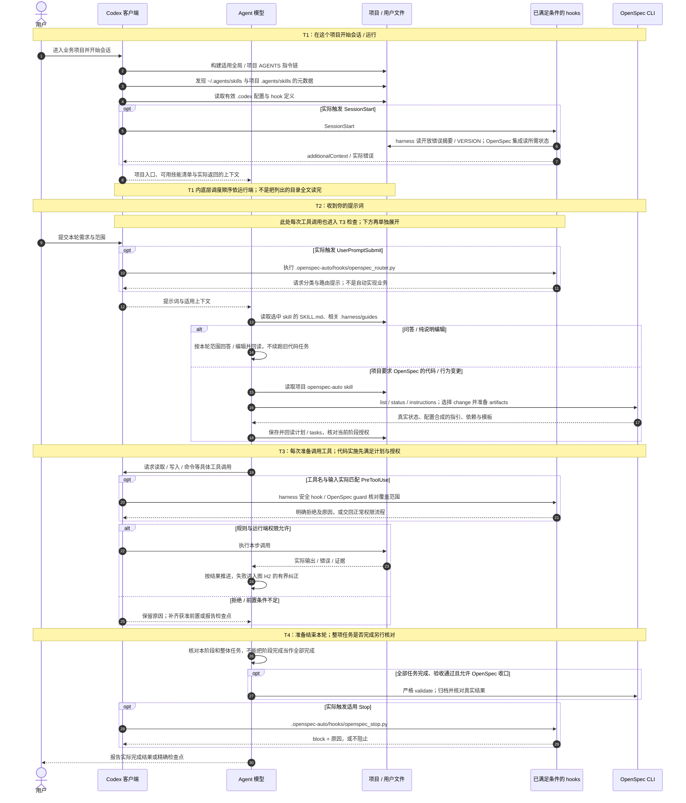

**Codex 这一条线的入口是 AGENTS 指令链、可发现 skills 与有效 `.codex` 配置。** `.harness` 和 `.openspec-auto` 的动作来自这些入口的读取指引 / 事件注册，目录本身没有统一的“加载整包”动作。某个原生工具是否匹配模板 matcher，要看真实回调，不能把 `Edit / Write / MultiEdit / Bash` 的覆盖自动套到所有工具名。

## C. Claude Code：从会话开始到本轮结束

### 图 L：Claude Code 的四个时间点与目录读取

```mermaid
sequenceDiagram
    autonumber
    actor U as 用户
    participant R as Claude Code 客户端
    participant A as Agent 模型
    participant F as 项目 / 用户文件
    participant H as 已满足条件的 hooks
    participant O as OpenSpec CLI

    Note over U,O: T1：在这个项目开始会话
    U->>R: 进入业务项目并开始会话
    R->>F: 按版本与指令模式读取适用 CLAUDE / AGENTS 入口
    R->>F: 读取适用 .claude 设置 / 无路径限制的规则
    R->>F: 发现 ~/.claude/skills 与项目 .claude/skills 的技能信息
    Note over R,F: ~/.agents/skills 与项目 .agents/skills 不是此处默认技能来源
    opt 实际触发 SessionStart
        R->>H: 按有效 .claude/settings.json 注册调用脚本
        H->>F: harness 读开放错误摘要 / VERSION；OpenSpec 集成读所需状态
        H-->>R: 实际上下文或错误
    end
    R-->>A: 当前实际加载的入口、技能清单与上下文

    Note over U,O: T2：收到你的提示词
    Note over R,H: 计划阶段的实际工具调用也进入 T3 检查；不是等改源码才检查
    U->>R: 提交本轮需求与范围
    opt 实际触发 UserPromptSubmit
        R->>H: .openspec-auto/hooks/openspec_router.py
        H-->>R: 请求分类与路由上下文
    end
    R-->>A: 提示词及适用上下文
    A->>F: 匹配需求或按显式调用读取 .claude/skills 中的 SKILL.md
    A->>F: 按项目路由读取相关 .harness/guides 与必要 references
    opt 访问匹配文件时，包括 T3 中的访问
        R->>F: 加载适用子目录指令 / .claude/rules 路径规则
        R-->>A: 规则指引；指向 Guide 时仍需完整读取对应正文
    end
    alt 问答 / 纯说明编辑
        A->>A: 只处理当前范围，不启动旧代码工作流
    else 本轮应采用 OpenSpec
        A->>O: list / status / instructions
        O-->>A: change 状态、项目配置与 schema 合成的指引
        A->>F: 准备 artifacts / 计划 / tasks，核对实施阶段授权
    end

    Note over U,O: T3：每次准备调用工具；代码实施另有前置门槛
    A->>R: 请求具体工具调用
    opt 实际匹配 PreToolUse
        R->>H: 执行匹配的 harness 安全检查与 OpenSpec guard
        H-->>R: deny + 原因，或交回正常权限流程
    end
    alt 规则与运行端权限允许
        R->>F: 执行当前获准步骤
        F-->>A: 实际结果；失败由 Agent 按图 H1 / H2 记录并纠正
    else 被拒绝 / 前置不足
        R-->>A: 报告原因，禁止换写法绕过
    end

    Note over U,O: T4：准备结束本轮
    A->>A: 核对实际完成步骤与仍未获准 / 未验证事项
    opt 全部任务与验收完成且允许归档
        A->>O: 严格 validate；归档并核对输出与文件结果
    end
    opt 实际触发适用 Stop
        R->>H: .openspec-auto/hooks/openspec_stop.py
        H-->>R: block + 原因，或不阻止
    end
    A-->>U: 如实交付或报告停止位置
```

**两端可以使用相同的 harness / OpenSpec 脚本，但配置入口与默认技能目录各自独立。** Claude 的路径规则给出项目 Guide 的读取提示；Codex 主要依 AGENTS 的 Guide 表。Claude 的 skill 自动调用还受 frontmatter 等调用策略限制，不能把所有可调用技能都画成必定自动运行。

## D. harness：错误如何记录，自主纠正由谁完成

### 图 H1：从真实失败到错误记忆，再到下次读取

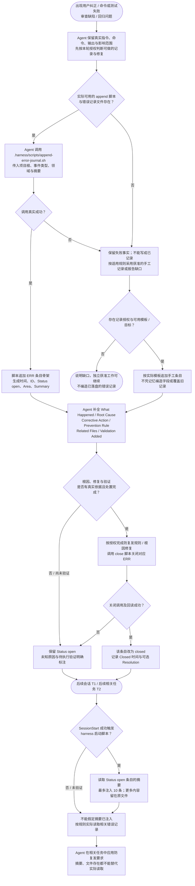

**这里的追加动作是 Agent 主动发起的工具调用。** 本次已读的 append 脚本只创建骨架，多项正文最初为“待补充”；它不会自动分析堆栈、推断根因或完成修复。SessionStart 脚本只负责读取开放条目摘要，不负责捕获所有失败并写日志。

| 已核对的记录动作 | 实际效果 |
|---|---|
| `bash .harness/scripts/append-error-journal.sh . EVENT AREA SUMMARY` | 要求记录文件已存在；成功后追加骨架并返回 ERR-ID。示例占位符需用实际事件、领域与摘要替换 |
| Agent 补全条目正文 | 填写错误事实、根因、纠正动作、防复发规则、相关文件、已新增验证；未确认 / 未执行分别标注 |
| `bash .harness/scripts/read-error-journal.sh .` | 当前 Shell 实现只输出前 240 行；相关记录在此范围外时须继续实际读取，不能声称已经通读全文件 |
| `bash .harness/scripts/close-error-journal.sh . ERR-ID RESOLUTION` | 针对对应条目把 open 改为 closed，并记关闭时间及可选处置说明；失败不算关闭成功 |
| `.harness/hooks/session_start.py` | 从文件读取 open 摘要，最多注入 10 条；closed 条目不再选入。没有摘要输出也可能表示没有开放条目，不能单靠空输出推断回调没执行 |

[追加脚本](../harness-engineering/scripts/error-journal/append-error-journal.sh)、[读取脚本](../harness-engineering/scripts/error-journal/read-error-journal.sh)、[关闭脚本](../harness-engineering/scripts/error-journal/close-error-journal.sh)、[启动摘要实现](../harness-engineering/scripts/hooks/session_start.py)、[项目错误记忆规则](../harness-engineering/go-harness/AGENTS.md#错误记忆)

### 图 H2：Agent 的有界自主纠正循环

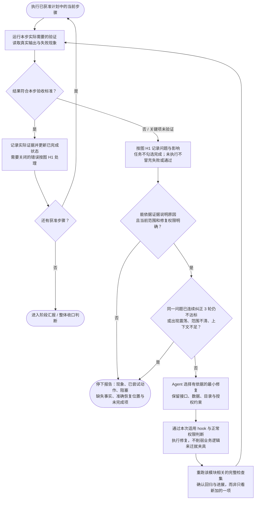

循环主体是 **Agent：观察 → 判断 → 调工具修复 → 读取结果 → 再判断**。harness 入口和 implement skill 规定停止纪律；图中的三轮限制表示 Agent 应遵守的规则，不代表已经核实运行端存在强制计数器或独立自动修复服务。[纠正与停止规则](../harness-engineering/go-harness/AGENTS.md#迭代与停止纪律verifycorrect-loop)、[分阶段实施 skill](../harness-engineering/skills/harness-implement/SKILL.md)

这个循环仅适用于当前获准的实施 / 验证任务。当前用户只要求文档或问答时，按本轮范围处理；不借“纠正循环”恢复旧代码任务、跑代码门禁或扩写其他规则文件。

## E. OpenSpec：计划怎样形成，任务怎样逐步执行

**OpenSpec CLI 提供状态、模板、依赖、校验与归档；Agent 根据这些指引编写计划并调用工具执行任务。** `tasks.md` 不会因为存在或变成 ready，就被 CLI 自动当作脚本逐行执行。

### 图 O1：从需求到可实施计划

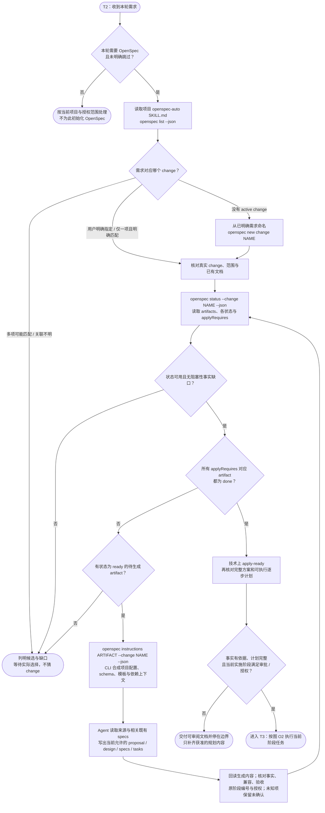

| 常见文件 / 状态 | 在计划中回答什么 | 与执行的关系 |
|---|---|---|
| `proposal.md` | 为什么改、目标 / 范围、影响与约束 | 定义本轮变更，不直接执行代码 |
| `design.md` | 怎么实现、兼容 / 风险、失败处理与回滚 | 给实施者明确决策，不能把未确认选择留给临场猜测 |
| 相关 spec delta | 什么可观察行为与场景必须满足 | 为任务验收提供契约；结合已有规范核对一致性 |
| `tasks.md` | 按什么步骤、前置条件、验证与停止标准实施 | Agent 按顺序执行并按真实证据更新清单；未执行项不勾选 |
| `ready` / `done` | 某个 artifact 的依赖是否允许生成、所需文件是否已满足状态判定 | artifact 为 done 不能直接推出业务已实现或用户已批准 |
| `applyRequires` | 当前 schema 允许进入实施所要求的 artifacts | 全部 done 形成技术前置，仍须计划及阶段授权 |

**依赖顺序以当前 CLI 的 `status` / `instructions` 为准。** 表中四类文件是常见职责，不意味着每个 schema 都有相同文件或必须按表格的先后串行生成。已有完整原计划直接复用，不能重排已确认阶段；OpenSpec 文档可承载完整方案，无需另外制造相互冲突的计划。

### 图 O2：执行 tasks、纠正失败、阶段验收与归档

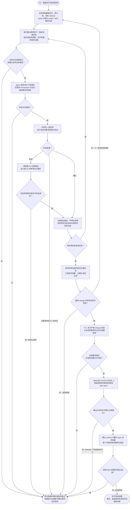

任务执行中若发现计划、契约或范围有缺口，先停在受影响步骤，更新获准 artifacts / 方案并按需取得对应授权，再重新核对技术就绪与任务顺序；不靠多试几次绕过缺口。单次工具放行、一个任务完成、某阶段通过和整体 change 完成分别报告。

严格校验示例是 `openspec validate NAME --type change --strict --json --no-interactive`；其结果不替代业务验收。归档需读输出和实际文件，`Aborted. No files were changed.` 即使退出码为 0 也不算成功。Stop 与真实归档状态冲突时报告证据和阻塞，不新建空 change 绕过。[本地自动流程 skill](../openspec-auto-bootstrap/templates/repo/.agents/skills/openspec-auto/SKILL.md)、[请求范围及 hook 说明](../openspec-auto-bootstrap/README.md#8-日常使用方式)

## F. 原有总览、全部判断分支与注释

下方保留此前 HTML 的配置生效总览与解释，并保留原 Markdown 的六张详细图及全部注释。总览统一用 T1—T4 编号；后面的“图 1—图 6”继续对应原来的六张图。新增图 C / L / H1 / H2 / O1 / O2 分别用于两端时间线、错误记录与纠正、计划与任务执行。

## 0. 项目里的配置，到底什么时候起作用？

**先看这条时间线：启动时加载适用的项目入口 → 接到任务后读取相关 Guide / skill → 进入 OpenSpec 时由 CLI 读取变更与配置 → 每次受控工具调用前检查 → 完成时验证 / 归档 / Stop。** 这些时间点不是“启动后把所有目录全部读入”。

此处“起作用”分为两种：规则文本进入模型上下文后指导决策；CLI / hook 在被实际调用时读取配置并执行判断。规则被读到，不表示其要求的动作已自动执行。

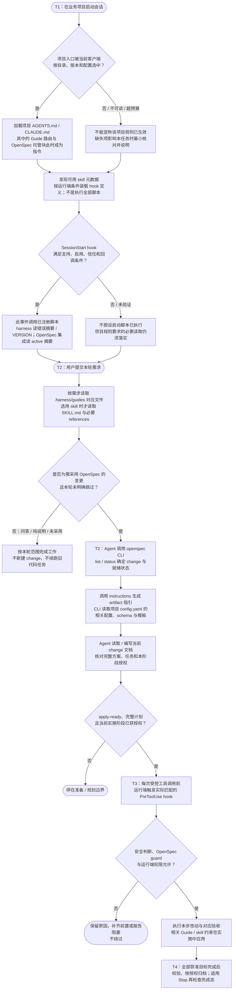

### 逐个路径看生效点

| 项目内的文件 / 目录 | 谁读取或调用 | 什么时候起作用 | 没有发生这一步时 |
|---|---|---|---|
| 根目录及适用子目录的 AGENTS.md / CLAUDE.md | Codex / Claude Code 运行端；必要时 Agent 实际回读 | 启动构建适用指令上下文。Claude 的部分子目录入口在访问相关文件时进入；Codex 的项目链按启动目录构建。具体分支见图 2 | 文件在磁盘上不代表在当前上下文中；也不能假设两个客户端都默认读取两种文件 |
| 上述入口内的 Guide 加载表、OPENSPEC-AUTO 托管块 | Agent | 入口加载时成为行为规则；收到相关任务后用于路由和决定后续读取 | 不会仅因为存在该段文字，就已经执行了 OpenSpec CLI 或任何 Guide 中的命令 |
| .harness/guides/*.md | Agent | 收到具体任务后，按加载表读取相关 Guide；在对应设计、改动或审查之前应用项目约定 | 不会整目录自动预载；Guide 文件存在不代表模型已知道正文 |
| .claude/rules/harness-*.md | Claude Code 的路径规则机制 | 访问匹配文件时加载路径规则；本地规则示例随后要求 Agent 完整读取所指 Guide | 这里只是读取指引，不能把它等同于 Guide 正文已经加载；Codex 仍依 AGENTS 路由 |
| .agents/skills/* / .claude/skills/* 中的 SKILL.md | 运行端发现元数据；Agent 选用正文 | 本会话提供可用名称与描述等信息；任务匹配或显式调用时读取正文，后续资源按需加载 | 名称出现在清单不等于正文已读、脚本已跑或检查已通过 |
| .harness/hooks/*.py 与 .harness/scripts/* | 运行端事件，或 Agent 按规则调用 | SessionStart 可读错误摘要与 VERSION；PreToolUse 可检查其覆盖的操作；其他脚本在被明确调用时执行 | 目录和脚本没有“存在即运行”的行为；错误摘要也不能替代必需的原记录读取 |
| .codex/hooks.json / .claude/settings.json 中的注册 | 当前运行端的配置与事件系统 | 定义从哪里调用脚本；实际执行还需事件匹配、启用、适用信任及回调成功 | 注册不等于执行。hook 放行也不等于沙箱或审批已经放行 |
| openspec/config.yaml（项目使用该配置时） | OpenSpec CLI | Agent 调用 instructions 等相关工作流命令时，CLI 解析配置；context 与对应 artifact 的 rules 随指引返回模型，schema 参与工作流选择 | 不是两个客户端原生的启动指令文件；仅放在项目里不会让模型自动获得全部内容 |
| openspec/changes/NAME/ | Agent 与 OpenSpec CLI | 选定 change 后，status / instructions 读取状态与依赖；实施时依据真实 artifacts 与 tasks；校验与归档时再次读取 | 不会把所有 active change 的全部文档都自动作为本轮任务；不明确时不能猜关联 |
| openspec/specs/ | Agent 与 OpenSpec CLI | 研究 / 方案涉及既有行为时读取相关规范；归档合并实际 spec delta 时使用基线 | 目录存在不等于所有规范已在上下文，也不等于代码自动符合规范 |
| .openspec-auto/hooks/* 与 tools/* | 已安装集成的运行端 hook | SessionStart 供上下文、UserPromptSubmit 做路由、PreToolUse 检查识别到的写入、Stop 检查其覆盖的完成态 | 这是 OpenSpec 自动集成的执行层，与 openspec/ 里的规范内容分开；没有真实回调就不能宣称已守门 |

OpenSpec 配置的读取时机依据 [官方项目配置说明](https://github.com/Fission-AI/OpenSpec/blob/main/docs-lab/customize/project-config.md)。这里描述其工作机制，不声称任一业务项目已存在该文件或已支持所有新字段；实际安装版本与 schema 应以项目事实为准。

### 改了文件以后，什么时候能看到影响？

- **改项目入口：** 已有会话不应被当作每条消息都重新读取文件。需要继续使用新规则时，按运行端加载机制重新进入上下文，并满足用户要求的实际回读；“保存了文件”不是“当前模型已看到新内容”的证据。
- **改 Guide / SKILL.md：** 新内容在对应正文被再次读取或由运行端重新注入后影响后续决策，不会追溯修改先前输出。不要为确认加载而例行扫描整个技能库。
- **改 OpenSpec config.yaml：** 后续相关 instructions / 工作流调用解析到新配置后，才把新指引提供给 Agent；既有 proposal / design / tasks 不会因此自动改写。需要修改既有 artifacts 时，另按当前授权处理。
- **改 hook 配置或脚本：** 运行端必须实际加载相应定义、满足适用信任要求，并在下次匹配事件执行。配置刷新方式因平台而异，不能一概承诺立即生效；Codex 新增或变化的非托管 hook 定义可能需要重新审阅与信任。
- **改内容源仓库：** 只改 skills / harness-engineering / openspec-auto-bootstrap 内容源，不等于业务项目已安装的副本同步更新；实际交付位置与同步方向需分开确认。

### 两个示例，把加载和执行连起来

**请求“修复订单重复扣款”时：** 项目入口已在启动阶段提供项目纪律 → Agent 按任务读取支付 / 数据一致性相关 Guide 与 skills → 项目采用自动 OpenSpec 时选定或创建匹配 change → CLI 的 instructions 读取相关 config 与 schema，Agent 据此准备文档 → apply-ready、完整计划与阶段授权均满足后才能改代码 → 工具调用前检查 hook 和权限 → 按项目验收并在获准范围收口。此为流程示例，不代表本机存在该订单项目或已执行修复。

**请求“只解释订单状态机”时：** 入口规则仍然适用，Agent 可以读取相关源码 / Guide 帮助回答；本轮不因此创建 change、不恢复旧代码实施、不运行代码门禁。若启动时 OpenSpec SessionStart 已经读过 active 摘要，那是启动事件的既有行为，不是这个只读问题要求启动开发流程。

下方保留原文的五张流程图、一张时序图、判断分支、全部注释与依据；本总览继续使用“图 0”编号。HTML 中图中文字可缩放，注释位于图下方。

核对日期：2026-10-21。本文说明**已接入相应组件的业务项目**如何工作，依据当前本地 `skills`、`harness-engineering`、`openspec-auto-bootstrap` 内容源与官方文档绘制。文中命令均为流程示例，本次绘图没有执行这些命令。

本文把三类行为分开：**运行端自动发现 / 注入**、**Agent 按规则决策 / 读取**、**CLI / hook 实际执行**。图示不是对某个业务项目安装、加载、权限或门禁状态的实测报告；各客户端版本、配置、信任状态和上下文预算仍以实际运行端为准。

阅读顺序：图 1 看全程；图 2 看客户端入口；图 3 看 Guide / skill；图 4 看 OpenSpec 准备和授权；图 5 看实施与收尾；图 6 看事件时序。支持 Mermaid 的 Markdown 阅读器可直接显示这些图。

## 1. 总流程：入口规则、项目约定、工程知识与变更流程如何协作

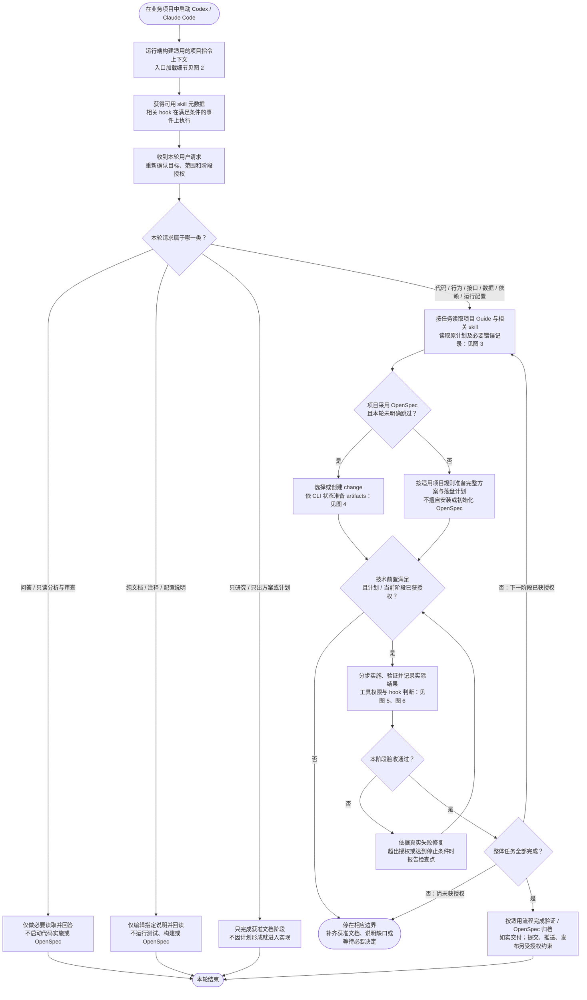

**注释：**

1. `harness` 在这里是一组项目规则、Guide、工作流 skills 和 hooks，不是启动后必须整体运行一次的独立服务。入口文件里的规则进入上下文后，Agent 再读取本次任务需要的 Guide。
2. 技术 skill 提供通用工程知识；harness Guide 提供项目约定；`openspec-auto` skill 编排变更流程；`openspec` CLI 提供变更状态与操作。它们不是互相替代的四份完整规范。[本地分工依据](../skills/README.md#与-harness-engineering--openspec-auto-的分工)
3. 新会话、复杂任务、阶段切换本身不要求 `harness-doctor`。正常读取相关规则、原计划、错误记录和技能正文，也不等于运行诊断。
4. “纯说明”按实际影响判断。改超时值、依赖清单、请求字段或数据结构不因文件名像文档就获得豁免；“改 README 并修登录接口”仍包含代码任务。只修改文档中的代码示例则按实际编辑目标和行为影响判断。
5. 研究、计划和实现的授权分别判断。已有明确授权直接复用；只有计划文档授权时停在计划，不能自动进入实施。`apply-ready` 也不能替代授权。

## 2. 启动加载：Codex 与 Claude Code 的分支

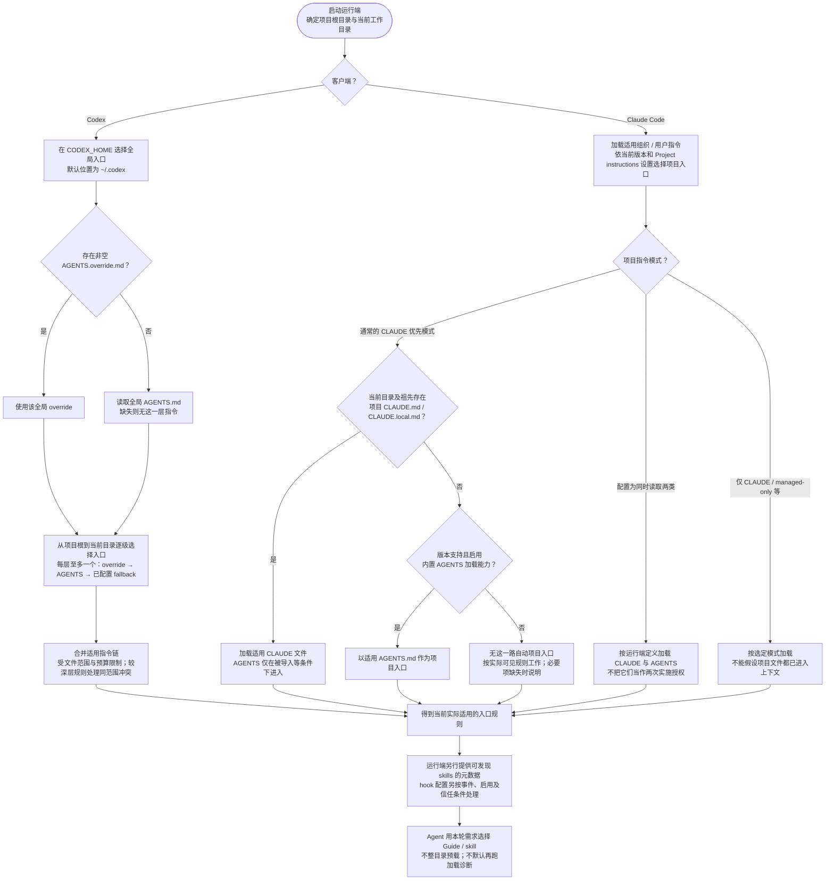

**加载边界：**

| 对象 | 何时进入上下文 / 执行 | 不能据此推出什么 |
|---|---|---|
| Codex `AGENTS.md` 指令链 | 启动一次运行时构建；读取全局与项目适用层级 | 不代表每条消息、每次工具调用都自动重读 |
| Claude 指令文件 | 启动时读取适用入口；部分子目录规则在访问相关文件时加载 | 不能把某版本的 `AGENTS.md` 支持套用到所有版本 / 配置 |
| `.claude/rules/harness-*.md` | 匹配路径被访问时，路径规则提供 Guide 读取指引 | 指引进入上下文不等于被指向的 Guide 正文已完整读取 |
| `.harness/guides/*.md` | Agent 按入口加载表和任务需要读取 | `.harness/` 存在不等于所有 Guide 已加载 |
| skills 列表 | 运行端先提供名称 / 描述等元数据；Codex 清单还含路径 | 清单可受配置和预算限制；列出不等于正文已读或任务已执行 |
| hook | 运行端支持、配置有效、启用、满足适用信任要求、匹配事件且实际执行时 | 脚本存在或注册成功不证明本会话已回调，更不证明拒绝路径有效 |

Codex 的入口选择与启动时机构建依据 [AGENTS.md 官方文档](https://learn.chatgpt.com/docs/agent-configuration/agents-md)；没有可识别项目根时，只检查当前目录的项目入口。Claude 的模式与子目录行为依据 [项目指令官方文档](https://code.claude.com/docs/en/memory)。截至核对日，Claude 原生 `AGENTS.md` 支持要求相应版本与内置能力；官方注明从 v2.1.277 起提供，仍有配置和会话限制。本机正在使用的 Claude 版本未在本次绘图中检测。

**项目落地点：** Codex 工作流 skill 通常在项目 `.agents/skills/`；Claude 对应副本在 `.claude/skills/`。本地技术 skills 源仓库默认同步到 `~/.agents/skills`，这不证明 Claude 的 `~/.claude/skills` 也已安装。源仓库更新也不等于既有业务项目的安装副本自动刷新。[技能发现依据](https://learn.chatgpt.com/docs/build-skills)、[Claude skill 位置依据](https://code.claude.com/docs/en/skills)、[本地安装与加载说明](../harness-engineering/README.md#项目入口skills-与-guides-如何加载)

## 3. 每轮任务：按需加载 Guide / skills 与处理缺口

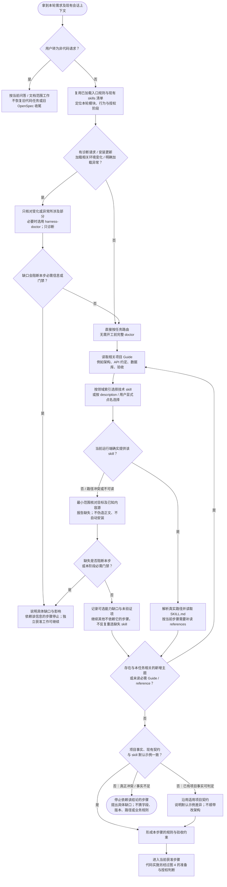

**注释：**

- Guide 与 skill 可以互相指向，图中先 Guide 后 skill 是便于阅读的常见路线，不是两个运行端都强制遵循的底层调用顺序。已明确单一专项时，可直接读取对应 skill。
- Codex 可通过 `$skill-name` 显式选择，Claude 可通过 `/skill-name` 调用；任务匹配也可触发选用，但仍受 skill 自身调用策略限制。例如 Claude 的 `disable-model-invocation: true` 不允许模型自行触发。明确点名也不授予部署、提交等额外权限。[Codex 按需加载](https://learn.chatgpt.com/docs/build-skills)、[Claude 调用控制](https://code.claude.com/docs/en/skills)
- 以当前 Go Guide 为例：每批先选最多 3 个相关 skill，后续处理新主题前再补读；这是分批策略，不是整项任务的数量上限，也不能用来跳过必要专项。其他技术栈按各自项目路由，不套用 Go 清单。[本地索引](../harness-engineering/shared/guides/go/skills-index.md)
- `harness-doctor` 不自动安装、同步、启用或授予 hook 信任。缺失可选能力不阻断独立工作；缺失必需验收能力时，相应结论保持“未验证”。[诊断边界](../harness-engineering/skills/harness-doctor/SKILL.md)
- **四个状态分别记录：文件存在 → 本会话可发现 → 正文已读取 → 本次实际执行 / 通过。** 后一状态需要相应证据，不能从前一状态直接推定。

## 4. OpenSpec：先准备变更，再判断是否允许实施

本图从“本轮确实涉及代码或行为变更”开始。纯问答、纯说明编辑不走本图，也不为路由而查询 active changes；但已启用的 OpenSpec SessionStart hook 可能在启动事件中自行读取过摘要，两者不是同一个动作。

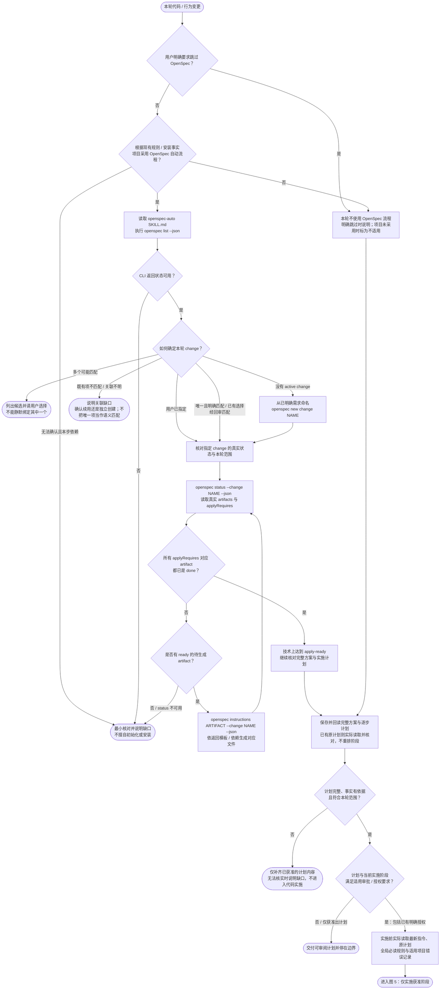

**关键注释：**

1. 常见 artifacts 是 proposal、design、spec delta、tasks，但**生成依赖以当前 schema 的 `status` / `instructions` 返回值为准**，不硬编码为一条对所有项目都相同的文件顺序。`apply-ready` 判断对应 `applyRequires` 完成，不等于所有业务任务完成。[自动工作流正文](../openspec-auto-bootstrap/templates/repo/.agents/skills/openspec-auto/SKILL.md)
2. 完整方案应覆盖需求来源、目标 / 非目标、现状事实、涉及文件与版本、兼容约束、风险、失败处理、回滚和验收。每步计划应有前置条件、改动、检查、可复核证据、停止条件、交付物和状态。OpenSpec artifacts 可承载这些内容，无需为同一任务制造冲突的两套计划；未覆盖项须补齐。
3. `research → plan → implement → review` 是可选的工作流分工。显式进入这些 skills 时遵守各自边界：research 约束集需批准后进入 plan，plan 获批后才 implement。普通小改不强制完整 RPI，仍须满足适用的前置计划要求。[research](../harness-engineering/skills/harness-research/SKILL.md)、[plan](../harness-engineering/skills/harness-plan/SKILL.md)、[implement](../harness-engineering/skills/harness-implement/SKILL.md)
4. hook 的 change 名称匹配、唯一项选择或保存的当前选择只是辅助状态，不证明变更与本轮需求语义相符。Agent 仍须核对；多个候选不明确时必须询问。CLI 命令失败、JSON 状态不可读或 artifact 卡住时，不得把它们写成已就绪。
5. 用户明确跳过 OpenSpec 是流程选择，不会自动修改 hook 配置或解除运行端权限。若现有 guard 仍拒绝工具调用，保留原因并报告冲突，不更换命令写法绕过。
6. 未装组件不等于应立刻安装。只有得到对应初始化 / 安装授权，才执行安装流程；全局工具、用户级配置与覆盖既有文件仍按适用规则判断。

## 5. 实施、验收、归档：每次写入与完成声明都有分支

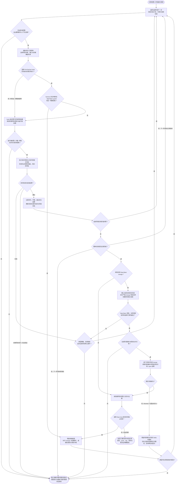

**执行与收口说明：**

| 判断点 | 具体依据与分支说明 |
|---|---|
| 改动前实际读取 | 自动注入不免除用户规定的实际读取。恢复任务、范围改变或规则更新后，重新核对适用规则；项目错误摘要不替代原记录。原计划缺失时不凭记忆编造 |
| 两种 PreToolUse | harness 安全 hook 处理其覆盖的危险操作 / 路径；OpenSpec guard 检查所识别源码写入的 change 状态。二者互补，均不是完整权限边界 |
| guard 放行 | 当前实现放行时不输出强制 `allow` 决策，交回正常权限流程；因此“通过 OpenSpec guard”不等于沙箱或用户批准了工具 |
| 工具覆盖 | OpenSpec 模板 matcher 为 `Edit / Write / MultiEdit / Bash`，Bash 仅识别部分源码写入模式。不同工具名、原生补丁工具、配置或依赖写入的实际覆盖需回调证据，不能从此图推定全面拦截 |
| hook 异常 | 缺失回调、异常或超时的处理取决于运行端和脚本；可能继续执行工具。harness 安全 hook 的文档明确说明其自身异常可 fail-open，不能画成“报错必拒绝” |
| 失败与停止 | 先读真实错误再修；同一问题连续自纠 3 轮仍不达标时，当前 harness 要求停手报告。业务事实、范围、授权不明时可更早停止 |
| 验收证据 | build / lint / 单测只证明各自范围。前端真实交互、API、数据一致性、外部依赖、性能等按项目及改动影响验证；关键项未验证不写 Ready |
| 严格 change 校验 | `openspec validate NAME --type change --strict --json --no-interactive`；不能替代项目业务验收。方案或范围有缺口时先回到 artifacts / 计划 |
| 归档命令 | 默认 `openspec archive NAME -y` 合并 spec delta；工具链 / 基础设施等符合当前 workflow 规则的变更可用 `--skip-specs`。纯文档请求不会因此创建 change；已经进入相关 change 的文档阶段按其获准范围处理 |
| 归档证据 | 当前自动工作流特别要求识别 `Aborted. No files were changed.`：即使退出码为 0，也不算成功。确认 change 已迁入 `openspec/changes/archive/`，并核对对应 spec 结果；按流程逐个归档后重新校验 |
| Stop 的边界 | Stop 仅做其实现覆盖的完成态校验，不证明任务全勾、业务验收或归档已通过。若归档结果与 Stop 判断冲突，报告真实状态与拒绝原因，不重新创建空 change 或换写法绕过 |

[本地 hook 与工作流说明](../openspec-auto-bootstrap/README.md#9-hook-触发与输出契约)、[当前 guard / 完成判断实现](../openspec-auto-bootstrap/templates/repo/.openspec-auto/tools/hook_common.py)、[harness 安全与回调边界](../harness-engineering/README.md#ai-行为安全的两层防护)、[Codex hook 发现与信任](https://learn.chatgpt.com/docs/hooks)、[Claude hook 生命周期](https://code.claude.com/docs/en/hooks)

## 6. 事件时序：自动加载、Agent 决策、hook 与 CLI 的责任边界

下面按生命周期示意主要交互，不承诺启动时各来源的底层调度顺序。相同事件上的多个 hook 不应被画成有固定的串行依赖；以实际运行端行为为准。

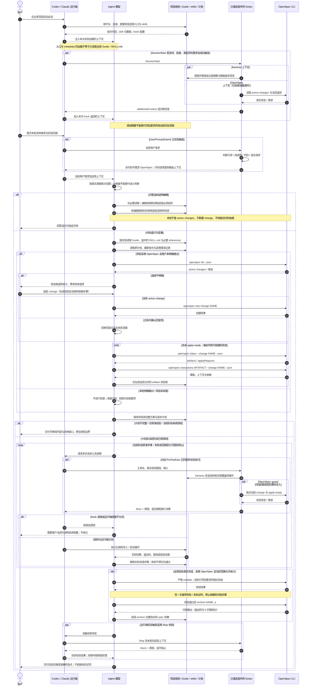

**时序补充：**

- hook 不替 Agent 阅读全部 skill，也不负责实现业务。Router 注入的是路由提示，选用 skill 与跟随任务仍是 Agent 的工作；CLI 返回的状态是 OpenSpec 判断依据。
- 图中的 `opt` 都是有条件路径。未启用、未信任、未匹配、运行端不支持或未取得回调证据时，不能声称该路径已发生。现有规则与正常权限判断仍适用。
- 当前 OpenSpec Router 为请求分类保存按 session / thread 标识区分的记录，Stop 可据有效记录跳过本轮非代码请求的旧任务校验；缺少标识或分类记录缺失 / 损坏时，不保证跳过。这个记录不授予源码编辑权限，也不替代 apply-ready。
- 时序中的循环是工作流示意，任一 CLI 错误、无可生成 artifact、规则冲突或停止条件均会提前退出。图 4 和图 5 给出了这些退出分支，不能把循环理解为无条件反复执行。

## 7. 职责与依据索引

| 层 | 负责什么 | 本次核对依据 |
|---|---|---|
| 用户指令与项目入口 | 本轮目标、授权、项目纪律、路由及边界 | [全局规则](/Users/xiaozhaofu/.codex/AGENTS.md)、[Go 业务 harness 入口示例](../harness-engineering/go-harness/AGENTS.md)；具体业务项目须换成其实际适用入口 |
| 客户端加载机制 | 哪些入口、元数据与事件会被发现 / 加载 | [Codex AGENTS.md](https://learn.chatgpt.com/docs/agent-configuration/agents-md)、[Codex skills](https://learn.chatgpt.com/docs/build-skills)、[Codex hooks](https://learn.chatgpt.com/docs/hooks)、[Claude memory](https://code.claude.com/docs/en/memory)、[Claude skills](https://code.claude.com/docs/en/skills)、[Claude hooks](https://code.claude.com/docs/en/hooks) |
| harness 项目约定 | 目录与依赖方向、契约、门禁、错误记忆 | [工作原理](../harness-engineering/README.md#工作原理)、[路径规则示例](../harness-engineering/go-harness/rules/harness-api-conventions.md)、[技术 skill 索引](../harness-engineering/shared/guides/go/skills-index.md) |
| 通用技术 skills | 语言、框架、并发、数据、安全、测试、性能知识 | [skills 内容源与组合边界](../skills/README.md)；执行时读取实际解析到的目标 skill，不预载全库 |
| 可选 RPI skills | 约束研究、可执行计划、分阶段实施与审查 | [harness 工作流技能](../harness-engineering/go-harness/AGENTS.md#工作流-skillsclaude-code-与-codex-同一套) |
| OpenSpec 自动编排 | 路由、选择 change、准备 artifacts、验证与归档 | [入口托管块](../openspec-auto-bootstrap/templates/repo/AGENTS.md)、[openspec-auto skill](../openspec-auto-bootstrap/templates/repo/.agents/skills/openspec-auto/SKILL.md) |
| OpenSpec hook 实现 | 上下文、路由、识别到的写入守门、完成态校验 | [集成说明](../openspec-auto-bootstrap/README.md)、[hook 共同实现](../openspec-auto-bootstrap/templates/repo/.openspec-auto/tools/hook_common.py)、[Codex 注册模板](../openspec-auto-bootstrap/templates/repo/.codex/hooks.json) |

本文仅维护图示说明及对应 HTML，不更改入口规则、skills、harness 模板、hook 配置或任何 OpenSpec 工作区。本次只做必要的只读核对、文档生成及回读；未运行 doctor、OpenSpec、测试、构建、同步、安装、提交或发布。文中预期分支不是实际运行覆盖率或通过结果。
